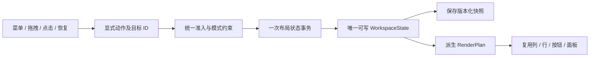

# 多串口重构改进方案

> 当前标签缺陷闭环见 [多串口组标签修复计划](MULTI_SERIAL_TAB_FIX_PLAN.md)：覆盖关闭组同步与资源释放、操作目标、激活一致性及模型防御缺口；代码修复、自动化回归及隔离桌面验证已完成，剩余验收边界见专项计划第 7 节。

> 状态：开始实施。本文规定后续重构顺序和验收门槛；不能把历史计划的“完成”视为本轮验收证据。
> 产品语义以用户最新裁决为准；本文明确替代旧文档中与下述规则冲突的 Shell 布局描述。

## 1. 目标与产品约束

目标是让串口运行态真正按组隔离，让布局操作只有一条状态写入路径，使新增组与默认组复用同一实现。

- 单串口组时，main/filter/chart/Shell 地位平等，可在分屏间自由拖动。默认无 subRow，显式组内分屏采用方案 A，恢复各格标签行。
- 多组时，串口子标签不能脱离所属组；Shell 为根级标签，只出现在一级栏。
- 分组级分屏只移动指定组，其他组与 Shell 保持位置。
- 已显示的一级、二级行均永久提供添加入口，所有二级行使用同一构造路径；右键菜单同样提供新建入口。
- 新建组保持 disconnected，等待用户手动连接。
- 快捷指令定义全局共享，触发、发送、解码和并发状态按来源组隔离；显示偏好保留全局/按组设置。
- 本轮不改变自动发送跟随当前控制组的既有语义，不新增线程或依赖，不改发布流程。

## 2. 审查基线与失效原因

基线提交：`0f5f5ad`。审查通过实际模块和现有函数的最小运行探针发现：

| 问题 | 根因 | 后果 |
| --- | --- | --- |
| 两组首次会话均为 1，注册表按裸 sessionId 查全局 owner | 协议双方对唯一性理解不同 | 前一组接收被拒 |
| RAW/文本日志缓存与路径为全局单份 | 只拆目录，未拆运行态 | 混写、漏记、缓冲覆盖 |
| 重连先 claim，旧 cleanup 再 releaseGroup | 声明没有连接身份 | 新声明被旧事件释放 |
| 当前组 ID 与 manager 别名可不一致 | 动作隐式读取全局上下文 | 错组操作与保存 |
| Shell 位置与 pane 成员表分别维护 | 投影合并，收敛/激活/保存只读其中一份 | 空格、失活、恢复不一致 |
| 菜单拒绝而拖拽允许多组 Shell 进 pane | 准入散落各入口 | 产品规则被绕过 |
| 快捷触发只按 item.id 去重，写队列全局共享 | 共享定义与执行状态混淆 | 跨组漏发与阻塞 |

现有 `projectWorkspace()` 是只读渲染快照，不能充当可写模型。保留统一渲染管线，但不再把增加投影字段当成布局重构完成。

## 3. 运行态边界

### 3.1 串口会话

主进程按 groupId 持有端口和会话代次。IPC 以 `(groupId, sessionId)` 为完整会话身份；不同组允许相同 sessionId。迟到消息只能被所属组当前已连接会话接受。

无 groupId 的旧消息仅兼容默认组，不通过裸 sessionId 猜目标组。诊断用裸 sessionId 查询在有歧义时返回 null。移除组必须移除其全部路由记录。

每次连接申请返回 claim token。旧连接只释放与自身 token 匹配的声明。连接中再次连接必须在修改 claim/portPath 前拒绝；取消 opening 后，迟到 open 不能重新激活或占用端口。端口真正关闭前保留声明。

### 3.2 日志会话

按组保存普通文本/RAW 的 buffer、byteCount、filePath、flushError、overflowNotified；每个 tab 日志 entry 独立保存同类运行态。全局定时器只遍历，不持有某一组的当前文件。

- 目录仍为 `<logPath>/[日期]/<端口号>/`，Shell 为 `_shell`。
- 写入必须带 groupId，主标签使用对应组的真实 main id。
- 连接与断开只刷盘/关闭本组日志，不重置其他组 entry。
- 换端口前先完成旧组日志刷盘，失败则保留旧缓冲和路径并拒绝切换，不能把旧数据转存到新目录。
- 日期轮转、路径/编码/模式切换、总开关、手动保存和退出必须遍历全部日志流。写失败保留 buffer 和原路径，成功前不能覆盖未落盘内容。
- 自动日志关闭后不接收新文本；RAW 保留自身开关语义。活动文件保护收集全部组和标签的路径。

### 3.3 发送与快捷触发

每组一条有序发送链，不同组互不等待；入队和执行时都校验会话身份。失败不会使该组后续链永久 rejected。自动触发去重键为 `(groupId,itemId)`；释放只作用于本次执行。成功回显与滚动使用目标组终端。

## 4. 布局目标模型

业务身份和显示位置分开：

```text
WorkspaceState
  tabs[id]       : kind / ownerGroupId / panelId
  groups[id]     : 串口参数与业务子标签
  layout         : 标准分屏节点与标签行
  focusedTabId   : 唯一输入焦点
  activeGroupId  : 侧栏控制目标
```

标准分屏节点仅表达方向、子节点和比例；叶格持有行及独立 activeTabId。行只表达层级和成员位置。TabRow/subRow 是同一行控件的不同显示角色，tabPanel 与叶 Tab 1:1，串口组容器没有 panel。

- 每个叶标签恰好有一个有效显示位置。业务 owner 不随单组自由拖动改变。
- 每个可见格独立保留 activeTabId；全局焦点只决定键盘输入与焦点高亮。
- Shell 与串口叶共用放置和激活机制，不再通过 Shell 特殊字段补出一份隐形成员表。
- 空格收敛必须读完整行成员，Shell-only 格不是空格。
- 同一串口组在多组模式下的子标签只能位于该组布局范围内。默认组不采用独有的状态算法；旧 DOM id 可在适配边界保留。
- 布局仅持有 ID，不销毁或重建终端/parser/PTY 来完成移动。



`pane` 可保留为内部名称，但不得同时用 pane.tabIds 和 Shell.hostPaneId 表达同一位置。字段删除必须在所有消费者切换后进行，不建立长期双写。

## 5. 布局动作、转换与恢复

统一动作入口接受明确的 groupId/tabId/source/target，而非临时切模块别名：activate、move、split、resize、close、add/remove group、restore。

一次动作依次完成：校验业务归属与模式 → 更新成员/激活/焦点/比例 → 收敛空格 → 检查不变量 → 发布状态 → 调度一次渲染及保存。菜单能力、拖拽落点和程序化调用共用同一判据。

| 转换 | 处理规则 |
| --- | --- |
| 单组未分屏 → 分屏 | 所有叶标签可移动，其他格 active 内容保留 |
| 单组 → 多组 | 串口叶按 owner 收回组范围，Shell 提升一级；优先保留对应物理区域，删去由迁移形成的空格 |
| 多组 → 单组 | 将剩余串口叶和 Shell 投影到统一可拖动空间；保留有效分屏与相对位置 |
| 关闭组 | 先结束该组运行态，移除其业务叶；不关闭 Shell；修复失效位置与焦点 |
| 恢复 | 先建 tab 身份，再迁移位置，再归一化激活/比例，最后挂载 panel；不边恢复边保存半成品 |

旧配置继续可读。布局迁移由一个纯函数负责；在完整新模型与动作入口上线时一次提升配置 schema。迁移应确定、幂等，保留用户顺序，不在本轮首阶段提前升级 schema。序列化后恢复应保持位置、每格激活、焦点和比例等价。旧字段只在迁移边界读一次。

## 6. 实施阶段与验收

| 阶段 | 范围 | 验收门槛 | 状态 |
| --- | --- | --- | --- |
| R1 | 会话路由、日志隔离、claim 生命周期、按组发送/触发 | 同号会话、双组日志、重连/取消、慢端口并发的行为测试 | 代码与自动化验证完成；真实端口待验 |
| R2 | 显式组上下文，消除 manager 保存/回调对当前组别名依赖 | 对非控制组操作不改变其他组，归属查询与保存目标正确 | 代码与自动化验证完成；实际 UI 待 R5 |
| R3 | 标准布局状态、统一动作入口、Shell 与串口共用行激活 | 多格内容持续可见、Shell-only 格不折叠、拖拽与菜单准入一致 | 生产接入与自动化完成；完整交互待 R5 |
| R4 | 单↔多事务、版本化迁移、旧状态写入与字段清理 | 转换往返、关闭组、异常旧配置、保存重启等价 | 已接入并验证；完整交互待 R5 |
| R5 | 集成验收与规范收敛 | 隔离 profile 的快速 CDP、真实双端口、文档与实现逐项核对 | 待实施 |

每阶段先建立能暴露失效输入的测试，再改实现。已通过的阶段可独立本地提交；不自动 push、tag 或发布。不得因单测绿而跳过后续阶段。

### R1 必须覆盖

1. 两组 sessionId 同为 1 均可接收；某组重连/移除不改变另一组；断开与旧代次消息拒绝。
2. 两组同时写文本/RAW 各落对应目录；非默认主标签普通模式可保存；第二组连接不覆盖第一组 pending entry。
3. 一个日志流写失败不暂停或清除其他组；失败后重试、关闭开关、日期轮转、重连、路径设置变化保留数据归属。
4. 同组重连旧 cleanup 不释放新 token；重复连接、打开失败、opening 中取消与迟到回调不泄漏声明。
5. 一个端口慢写不阻塞另一个组；同组发送仍有序；两组同时触发同一命令均发送。

### R2–R5 必须覆盖

- 单组 main/filter/chart/Shell 各种两格/三格组合与拖动、右键、关闭、resize。
- 非当前组动作、两级分屏、Shell 位置固定、多组子标签不跨组。
- 每格 panel 有 active 状态、祖先可见、非零几何，不能只验按钮所在行。
- 一级/二级入口与右键一致，默认/新增组的尺寸、事件、字体与 fit 使用同一路径。
- 迁移与单↔多往返后所有叶唯一挂载，无幽灵标签、空格、失效 active 或 NaN 比例。
- CDP 等应用 ready 后立即开始，合并同一启动可完成的场景；测试失败必须非零退出。

## 7. 验证边界与记录

纯逻辑和模拟端口用于定位行为，不能替代真实驱动验收。没有互连串口对时，真实双端口字节隔离、长时间接收、最小化恢复和异常断开明确保留待验。CDP 只能使用工作区隔离 profile，不修改用户真实配置或终止用户现有应用。

实施进度、实际检查结果和剩余事项记录在本文后续条目；`agent_notes.md` 第 0 节应链接本文，旧设计的历史完成标记不能覆盖新的缺陷结论。

### 实施记录

- R1 已完成：注册表按 `(groupId, sessionId)` 接受当前已连接会话；禁止从入站字节反向登记新会话。
- 文本/RAW 缓冲、路径及失败状态按组，tab entry 的失败状态按标签；非默认组主标签普通日志可保存。连接、断开与重连只处理本组；换目的地或关闭开关前刷盘失败会保留数据并拒绝切换。
- claim 增加连接 token，保留旧口声明至真正关闭，覆盖关闭失败、重复 opening、取消与迟到 open；成功写回调校验原会话。
- renderer 发送链按组；快捷触发去重按组与命令；Text 发送滚动目标组。两个组的相同命令可并发，同组仍保持顺序。
- 补充跨日首次刷盘的重入检查，避免轮转内层已刷盘、外层再次写入同一快照；同名标签独立路径、首次标题正确参与命名。
- 新增 `test/main-serial-fixture.js`（执行实际 main 函数、内存 FS/模拟端口）、15 项日志/连接行为测试、3 项发送行为测试及 registry/claim 回归。相关旧源码正则断言改为行为验证，主进程与渲染层实际模块加载门禁保留。
- 验证：`node scripts/run-tests.js` **590/590 通过**；`node --check main.js`、`node --check renderer.js`、`node scripts/check-renderer-module-load.js` 通过；`git diff --check` 无空白错误。未修改用户真实配置，未进行真实端口或本阶段 CDP 验收。
- R2 已完成：pane/标签归属按实际成员和完整 ID 查询；manager 保存、移动和归一化回调绑定所属组，激活不再临时切换模块别名。非默认组保存不覆盖默认组顶层兼容镜像。
- filter/chart 创建、关闭、设置和重命名使用所属组 store；过滤设置延迟保存每组独立，关闭组清理本组 timer。终端右键请求携带实际组 ID，连接/分屏/显示状态及菜单动作均按目标组读取。
- 补齐 manager 漏接的 onTabActivated 回调。新增 7 项实际 renderer 函数与真实 manager 行为测试，覆盖非控制组激活/移动/关闭/重命名、延迟保存、非默认主标签恢复和终端菜单上下文；替换过时源码写法断言。
- R2 验证：根项目 **597/597 通过**；renderer 语法与模块加载检查通过；`git diff --check` 无空白错误。未进行真实 DOM/CDP 或端口验收。
- R3 已接入既有 `tab-model.js`，没有另建竞争布局模型：`applyConfig` 在业务实例恢复完成后只导入一次，交互统一经 `dispatchWorkspaceAction` / `applyWorkspaceAction` 原子发布，再由 `buildRenderPlan` 驱动列/行/按钮/面板复用。恢复前旧 manager 与位置字段仅用于导入，完整版本化保存与字段清理留 R4。
- 单组 Shell 是 pane 的真实成员，Shell-only 格不会当空格折叠；每格独立 active。生产分屏移动已有叶，不制造无业务实例的 main；合并/关闭收敛成员。多组 Shell 禁止进入 pane，串口叶不能跨业务 owner。
- 外层显式列记录 `{ id, groupIds }` 与列局部 active，分组分屏只拆出指定组，其余组可继续共列，Shell 保持原列；组增删和组内移动复用已有面板与终端。N 格生成 N−1 条 gutter，相邻 resize 不修改第三格。
- 真实 renderer 函数测试覆盖 pane 节点身份/顺序/折叠、相邻 resize、共享列搬移、拖拽准入、菜单关闭分屏和可见面板 fit；修复关闭菜单读取旧 Shell 字段、拖动过程中提前记录尺寸导致松手漏发 PTY resize。
- R3 验证：当前根项目 **617/617 通过**；renderer/tab-model 语法及 renderer 模块加载通过；`git diff --check` 无空白错误。隔离 profile 的生产函数 CDP 验证三组仅拆指定组、共享列切换、三列可见几何、Shell 局部激活及关闭回单组，未出现重复 DOM ID，Shell term 引用不变；三格合成 pointer resize 有效。
- R3 验证边界：上述 CDP 直接调用生产入口/合成事件，不能替代原生菜单和真实拖拽验收。以下 R4 记录更新保存恢复状态；完整交互、实际双端口和长时运行仍留 R5。
- R4 已接入 `workspace-layout-state.js`：总配置 schema **v16**，布局快照内部 **v1**，只序列化身份与位置、顺序、局部激活、焦点、方向和比例。`main.js` 引用 `WORKSPACE_CONFIG_VERSION`；旧分组迁移常量 15 仅代表历史阶段。
- 迁移先规范业务清单，再导入布局；过滤 null/无效/冲突业务 ID 与未知布局叶，拒跨组成员，补回合法缺失叶，保留组和根 Shell 顺序。版本快照优先于旧兼容镜像；未知版本使用业务基线副本。升级前一次性保留 `config.v15.backup.json`，备份失败本次启动仅内存迁移、不覆盖原文件。
- 保存改为完整工作区单次快照：每组业务设置/filter/chart 清单、Shell 身份、模型布局及控制组同 tick 合并发送。apply/restore 期间不写半成品，flush 再查 guard，beforeunload 刷 pending。普通 settings 回声仅更新设置，不复活关闭标签或重建布局；reset 使用明确 scope 清理并重新导入，未新增外部 import-config 功能。
- 初始化后清两个旧布局缓存，业务 Shell 初始化与新建后删除四个旧位置字段；模型成为唯一布局运行态。启动导入 fallback、旧低层 API 与模型 null host 兼容字段仍保留，不宣称所有历史代码已彻底删除。布局移动继续复用终端/parser/PTY。
- 实际重启测试发现并修复：提升 Shell 后残留旧 pane 比例、恢复目标 pane 尚无 DOM、恢复期旧 persist 写空组、null 列 Shell 的局部 active 被过滤、空比例被无故均分。单组三格提升后剩余比例立即为 4/7 与 3/7，Shell term 引用不变。
- R4 验证：最新根项目 **636/636 通过**；codec 10/10、真实持久化函数 VM 6/6、loadConfig VM 2/2。语法与 renderer module-load 通过。隔离 v16 profile 保存→正常关闭→重启精确等价，检查真实 panel active、祖先可见及非零几何；真实 reset IPC 后清回默认组；同一 evaluate 新建 Shell/分屏并在 pending 保存时立即正常关闭，磁盘包含完整身份与两格布局。正常关闭证据不等于崩溃/断电安全。
- 未修改用户真实配置，未 push/tag/发布。R5 仍需原生菜单/真实拖拽、两级分屏与窗口变化 fit、入口一致性、实际双端口字节隔离、长时接收/最小化恢复/异常断开验收。

- R5 改为用户手动验收，不再截图检查。用户报告原清单 1/2/4/5/6/7 通过；原 3 发现合并/拖回排序错乱，另发现点击分屏内容区不切换侧栏控制组，两项进入缺陷闭环；不据此视为实际双端口/日志/长时运行通过。
- 本轮修复排序：按钮从末端按计划一次收敛，一级栏把组与 Shell 一起排序；显式列成员按根 order 混排，Shell 拖拽按指针计算落点并把目标行下标转换成全局顺序锚点。快照 v1 新增可选 order，保存组/Shell 交错位置；无 order 的旧快照继续按数组顺序恢复。
- 本轮修复内容激活：静态/动态 pane 共用 document click/focusin 委托，按实际 main/filter/chart owner 切侧栏控制组，跳过重新选择其他标签；Shell 保留原串口控制目标，其他格独立 active 与位置保持。
- 新增 6 项领域/真实 renderer 函数/codec 回归，覆盖四标签全部 24 种排列、组/Shell 混排、根拖拽指示落点、局部下标、点击/键盘焦点与真实侧栏同步、旧快照和交错顺序往返。最新根项目 **642/642 通过**，语法、renderer module-load 与差异检查通过。两项修复仍待用户定向复测；物理双端口与长时异常场景继续待验。
